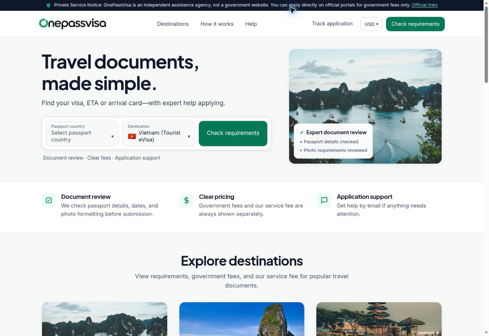
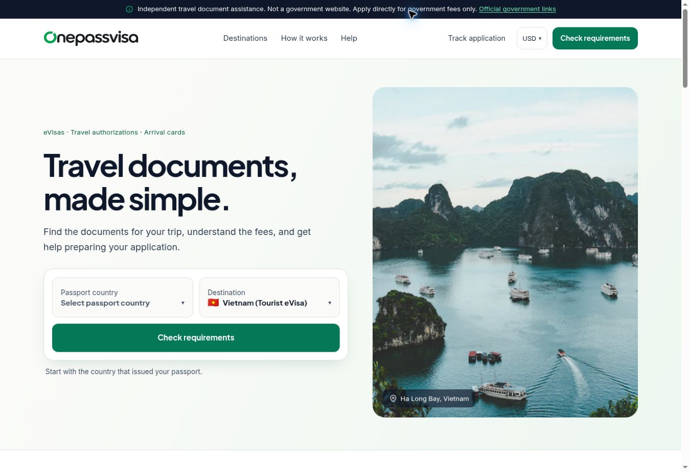

# OnePassVisa presentation refresh

Implemented against `cae8bdb5b735195880b4e841d288e0529f4f0ac9` on 28 October 2026. This is a design and editorial change, prepared for review without merging or deployment.

## What changed

- Deep green, ink, warm white, and mint surfaces; consistent typography, spacing, controls, and deliberate elevations.
- Editorial homepage with existing Ha Long Bay photography, a two-field/full-width-action checker, concise benefits, six destination cards, a numbered process, fee anatomy, FAQs, and a closing action.
- One destination-card system, larger page introductions, search above region filters, and a coherent detail template across all 18 products. Full preparation lists remain in the main content; sidebars link to them and emphasize fees, timing, and disclosures.
- Refined application, checkout, tracking, review, and receipt presentation. The four existing steps and all actions remain intact.
- Clearer services, help, about/contact, policies, and 404 presentation; three footer navigation groups and a compact cookie panel.
- Touch targets, long labels, table scrolling, visible focus, and reduced-motion rules. The mobile action bar is temporarily hidden while the cookie panel is visible to keep the two panels from covering each other.

The actual local fonts were inspected: Inter is regular weight 400; Plus Jakarta Sans is weight 700. Declarations now match those files, synthetic font weights are disabled, and bold styles use the available heading family. Original logo files and destination photography were reused.

## Before and after

Same desktop browser viewport, with the cookie choice already dismissed in both captures.

| Before | After |
| --- | --- |
|  |  |

## Verification

- JavaScript syntax check and CSS rule/declaration parsing passed; `git diff --check` passed.
- Independent AST comparison found no executable JavaScript changes outside string/template text. Template expressions remain unchanged.
- All 28 HTML pages retain original input semantics, IDs, labels, data attributes, currency bindings, and workflow hooks. No duplicate IDs or broken local links/anchors were found.
- Substantive policy content and all required-document list items were preserved. `assets/js/data-v6.js`, backend files, and deployment configuration are unchanged.
- Representative homepage, destination hub, visa and arrival-card details, application, checkout, tracking, services, help, about, policies, and 404 pages were rendered at 320, 360, 390, 430, 768, 1024, 1280, and 1440px widths. Final inspected pages had no page-level horizontal overflow; wide fee tables scroll within their containers.
- Exercised mobile navigation, long UAE document labels, searchable-selector empty results, checker results, destination filtering, regenerated cards, currency changes, and all four application steps through review using local example data.
- Populated checkout, receipt, and tracking templates were inspected with local example data. No application submission, payment, contact request, real passport upload, or production API operation was performed.
- Reduced-motion declarations were inspected and previewed with a local style simulation. Native OS reduced-motion preference and 200% browser zoom were not independently verified. Full assistive-technology and browser-engine coverage are outside this check.

## Existing content and behavior to review separately

These were preserved rather than guessed at in a presentation-only change:

- Support wording differs between “within 4 hours” and “within 4 business hours.”
- The existing tracking template hardcodes the “In review” timeline presentation.
- The existing receipt states that confirmation email was sent, and checkout states “Encrypted checkout”; those assertions were not independently validated.
- Existing company, fee, visa-rule, government-timing, and refund assertions were not fact-checked in this design task.

The computer folder `/download/onepassvisa logo` was unavailable; matching repository logo assets were used. `ivisaportal.com` could not be retrieved (502), so the supplied brief and project assets guided the design. No substitute reference site was used.
